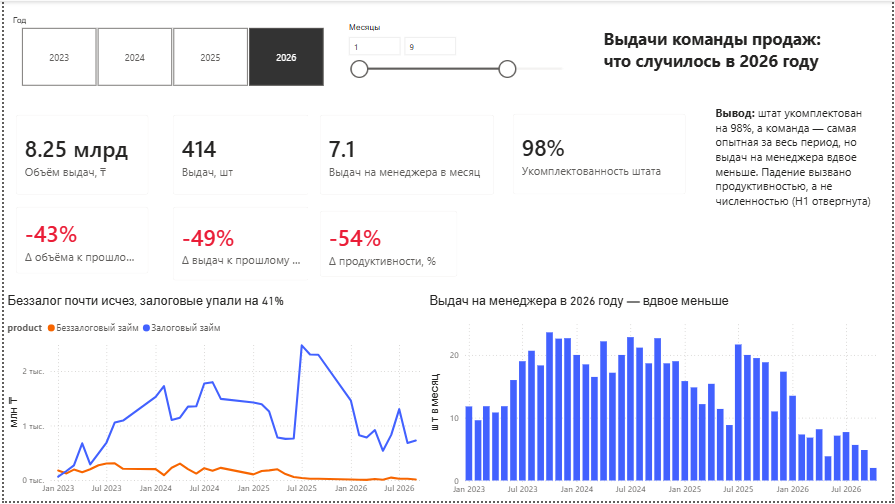
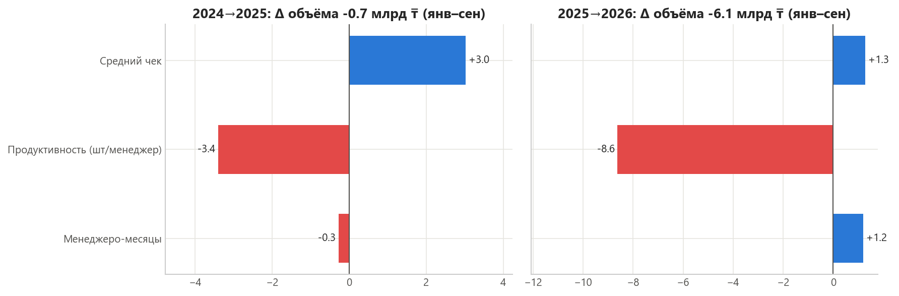
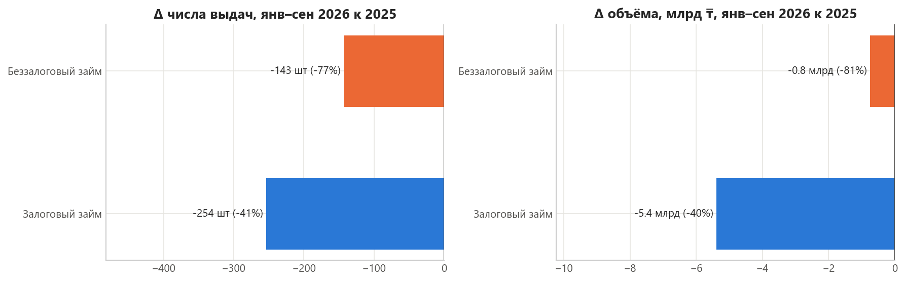
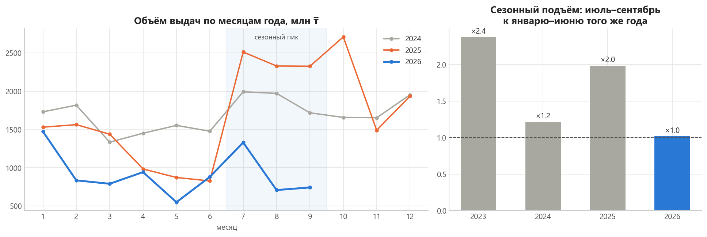
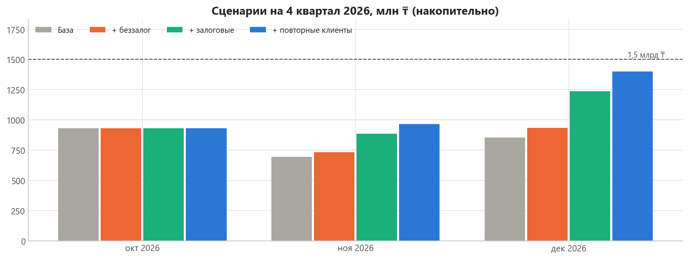

# Аналитика выдач команды продаж: залоговые и беззалоговые займы (Астана, 2023–2026)

Сквозной pet-проект по ТЗ «Аналитика бизнес-показателей», направление **финтех и банкинг**: SQL → Python → статистика → ML → дашборд → рекомендации.

## 📌 Summary: 3 главных вывода

1. **За январь–сентябрь 2026 года объём выдач упал на 43%** (8,2 против 14,4 млрд ₸), количество — на 49%. Команда при этом не уменьшилась, а средний чек не просел: **выдач на менеджера в месяц стало вдвое меньше** (15,6 → 7,1).
2. **Беззалоговые займы почти исчезли (−77%), но по деньгам главная потеря — залоговые:** −41% выдач и 88% потерянного объёма (−5,4 из −6,1 млрд ₸). Сезонного подъёма в июле–сентябре не было.
3. **Прогноз на 4 квартал 2026 — ≈2,5 млрд ₸ (−60% к 4 кварталу 2025), год ≈ 10,7 млрд ₸ (−48%).** Если с ноября закрыть половину разрыва по залоговым, вернуть беззалог и часть повторных клиентов, квартал вырастет до ≈3,3 млрд ₸, а декабрь выйдет на ≈1,4 млрд ₸.


📊 **Дашборд в Power BI:** 3 страницы — «Что случилось», «Где потеряли сделки», «Что будет в 4 квартале». Инструкция по сборке и DAX-меры лежат в [`powerbi/`](powerbi/README.md).



Скриншоты страниц «Где потеряли сделки» и «Что будет в 4 квартале» — в [`powerbi/README.md`](powerbi/README.md).

---

## 1. Постановка задачи

**Бизнес-проблема.** В январе–сентябре 2026 года команда выдала на **43% меньше**, чем годом ранее (8,2 против 14,4 млрд ₸), а количество выдач упало на 49%. Руководителю продаж нужно понять, что именно сломалось, сколько команда выдаст в 4 квартале и какие действия вернут объём.

| | |
|---|---|
| **Заказчик** | Руководитель направления розничных продаж |
| **Стейкхолдеры** | Руководитель продаж, менеджеры по продажам, партнёрский отдел (застройщики), риск-менеджмент |
| **KPI** | Объём выдач, ₸ · число выдач · выдач на менеджера в месяц · средний чек · доля повторных клиентов |

**Три главные гипотезы**

| # | Гипотеза | Как проверяли | Итог |
|---|---|---|---|
| H1 | Падение вызвано командой: стало меньше людей или больше новичков | Факторное разложение объёма, укомплектованность штата, когорты менеджеров | ❌ **Отвергнута.** Штат (6 человек, с мая 2026 — 7) укомплектован на 98% — лучше, чем в 2025 году (96%); команда 2026 года самая опытная. Упала продуктивность: −54% выдач на менеджера |
| H2 | Падение сосредоточено в беззалоговых займах, а залоговые держатся | Δ выдач и объёма по продукту, январь–сентябрь 2026 к 2025; χ² по структуре. Канал/партнёр указан не во всех заявках, поэтому делим только на залоговые и беззалоговые | ⚠️ **Частично.** Беззалог −77%, его доля 23% → 10% (p < 0,001). Но залоговые тоже −41% и дают 64% потерянных сделок и 88% потерянного объёма |
| H3 | Спад сезонный: начало года всегда слабое, второе полугодие «вытянет» | Помесячное сравнение 2026 с 2025 (Уилкоксон, знаковый тест), сезонный подъём июль–сентябрь к январю–июню | ❌ **Отвергнута.** 2026 ниже 2025 в 8 из 9 месяцев (p = 0,006). Сезонного подъёма не было: ×1,0 против ×1,2–2,0 в прошлые годы; в пик (июль–сентябрь) −61% |

<details><summary>Дополнительные проверки (статистические тесты)</summary>

| Гипотеза | Тест | Итог |
|---|---|---|
| Упал средний залоговый чек | Манн-Уитни, Уэлч | ❌ 19,1 млн ₸ в оба года (p = 0,53) |
| Новичкам нужен разгон | Манн-Уитни | ✅ для найма в течение года: 145 против 218 млн ₸ в первые 2 месяца (p < 0,001) |
| Команда «дожимает» план в конце месяца | Биномиальный | ❌ 16,1% выдач в последние 5 дней при ожидаемых 16,5% |
| Сделки через застройщика крупнее | Манн-Уитни | ✅ 19,4 против 17,4 млн ₸ (p < 0,001) |

</details>

**Дополнительная находка — повторные клиенты.** В январе–сентябре 2025 года 22% клиентов брали повторный займ, это 22% выдач, но в 80% случаев у другого менеджера. С октября 2025 года повторных выдач в данных нет; причину (клиенты перестали возвращаться или клиентов перестали сопоставлять в отчёте) нужно сверить с первоисточником.

## 2. Данные

4 049 выдач из отчёта одной команды продаж банка, январь 2023 – 12 октября 2026. Менеджеры и клиенты обезличены, фамилии синтетические.

| Поле | Описание |
|---|---|
| `issue_date` | Дата выдачи |
| `manager_id` | Обезличенный ID менеджера |
| `client_id` | Синтетический ID клиента |
| `product` | Залоговый / беззалоговый займ |
| `amount_kzt` | Сумма выдачи, ₸ |
| `source_product_raw` | Подпись продукта/партнёра из отчёта (134 варианта ручного ввода → справочник каналов) |

**Качество данных:** сверка с итогами исходного отчёта — 0 расхождений; дублей 0; потерь при очистке 0%. Найденные «подвохи»:
- менеджеры — реальные сотрудники: на рубеже 2023/24 и 2024/25 годов команда сменилась полностью (увольнения и новый найм). Утверждённый штат — 6 менеджеров, с мая 2026 года — 7; вакансии закрывались за 1–2 месяца, укомплектованность 94–99% в год;
- повторный клиент сохраняет ID, и в январе–сентябре 2025 года повторы хорошо видны. Но с октября 2025 года каждая выдача получает новый ID, так что retention клиентов считается на окне январь–сентябрь 2025;
- октябрь 2026 неполный, поэтому год к году сравниваем январь–сентябрь.

## 3. Структура репозитория

```
├── data/raw/                 # исходная выгрузка (xlsx)
├── data/processed/           # SQLite и витрины (генерируются, в .gitignore)
├── sql/queries.sql           # все SQL-запросы: CTE, JOIN, оконные функции
├── src/build_db.py           # загрузка xlsx → SQLite + справочник каналов
├── src/sql_utils.py          # загрузка именованных запросов
├── src/export_powerbi.py     # выгрузка модели «звезда» для Power BI
├── notebooks/fintech_loans_analysis.ipynb   # основной анализ (этапы 3–7, 9)
├── powerbi/                  # инструкция по сборке дашборда, measures.dax, .pbix
├── images/                   # графики для README
├── requirements.txt
└── LICENSE (MIT)
```

## 4. Как запустить

```bash
python -m venv .venv && source .venv/bin/activate     # Windows: .venv\Scripts\activate
pip install -r requirements.txt
python src/build_db.py                                # соберёт data/processed/loans.sqlite
jupyter lab notebooks/fintech_loans_analysis.ipynb   # выполнить все ячейки
python src/export_powerbi.py                          # таблицы для Power BI → data/powerbi/
```

## 5. Этапы ТЗ → где смотреть

| Этап | Что сделано | Где |
|---|---|---|
| 1. Постановка | Цель, гипотезы, стейкхолдеры, KPI | этот README, [ноутбук §1](notebooks/fintech_loans_analysis.ipynb) |
| 2. SQL | 8 запросов: сверка, KPI с `LAG`, витрина менеджеров с `RANK`, Парето, когорты, каналы через `JOIN` | [`sql/queries.sql`](sql/queries.sql) |
| 3. Предобработка | Типы, дубли, пропуски, выбросы, проверка ID, таблица «до/после» | [§3](notebooks/fintech_loans_analysis.ipynb) |
| 4. EDA | Распределения, boxplot, корреляции Спирмена, сезонность, профили сделок | [§4](notebooks/fintech_loans_analysis.ipynb) |
| 5. Метрики | Факторное разложение, retention и ramp-up менеджеров, retention клиентов, LTV/ROI (сценарий) | [§5](notebooks/fintech_loans_analysis.ipynb) |
| 6. Прогноз | Регрессия: модель A (сумма выдачи), модель B (объём менеджера); прогноз и сценарии на 4 квартал 2026 | [§6](notebooks/fintech_loans_analysis.ipynb) |
| 7. Гипотезы | Манн-Уитни, t-тест Уэлча, Уилкоксон и знаковый тест, χ², биномиальный тест | [§7](notebooks/fintech_loans_analysis.ipynb) |
| 8. Дашборд | Power BI: модель «звезда», DAX-меры, 3 страницы | [`powerbi/`](powerbi/README.md) |
| 9. Рекомендации | 6 шагов для бизнеса | ниже |

## 6. Ключевые графики

**H1. Факторное разложение: падение 2026 года — это продуктивность, а не численность команды**


**H2. Залоговые и беззалоговые займы, январь–сентябрь 2026 к 2025**


**H3. Сезонность: подъёма в июле–сентябре 2026 года не было**


## 7. Регрессионные модели

- **Модель A — от чего зависит сумма выдачи** (LinearRegression на log(суммы), обучение на 2023–2025 годах, тест на 2026 году): R² = 0,45, MAE = 8,1 млн ₸. Залог увеличивает сумму в 5 раз, госпрограмма 7-20-25 даёт +27%, канал застройщика +8%, вторичка и «свой залог» −20%.
- **Модель B — объём менеджера в следующем месяце:** линейная регрессия (MAE 116 млн ₸) **проиграла** наивному «среднему за 3 месяца» (MAE 74 млн ₸) из-за структурного слома 2026 года. Отрицательный результат зафиксирован; для планирования используется скользящее среднее.

## 8. Прогноз на 4 квартал 2026

Метод выбран проверкой на истории: «прогноз» 4 квартала 2025 года по данным до сентября 2025. Метод «доля 4 квартала от июля–сентября прошлого года» ошибся на +8% по кварталу, классический индекс сезонности — на +34%, среднее за 3 месяца — на +17%.

| Месяц | База, млн ₸ | Диапазон | Все шаги с ноября (рекомендации 1, 2, 4) |
|---|---|---|---|
| Октябрь | 931 | 811–1 051 | 931 |
| Ноябрь | 693 | 578–808 | 967 |
| Декабрь | 853 | 751–956 | 1 401 |
| **4 квартал** | **2 477** | 2 140–2 815 | **3 299** |

Октябрь сходится с фактическим темпом первых 12 дней (≈928 млн ₸). Помесячная точность ±30%, поэтому планировать стоит по кварталу.



## 9. Рекомендации: что делать завтра

1. **Разобраться, куда ушли залоговые сделки, — это 88% потерянных денег.** У менеджера стало 6,4 залоговых сделки в месяц против 12,0 в 2025 году. Вместе с партнёрским отделом пройти источники залоговых сделок и вернуть хотя бы половину разрыва: ≈14 сделок в месяц ≈ **+0,3 млрд ₸ в месяц**.
2. **Вернуть поток беззалоговых займов.** Вместе с риск-менеджментом выяснить, что изменилось в политике или скоринге. Темп 2025 года (≈16 сделок в месяц) даёт немного денег (+0,08 млрд ₸ в месяц), но возвращает поток новых клиентов и кросс-продажу к залогу.
3. **Заполнять продукт и партнёра в каждой заявке.** Сейчас в ≈30% выдач канал не указан, поэтому нельзя точно сказать, какие источники сделок пропали.
4. **Вернуть повторных клиентов и закрепить их за менеджерами.** В 2025 году каждый пятый клиент возвращался в среднем через 52 дня, но в 80% случаев к другому менеджеру. Нужны закрепление клиента, обзвон через 30–60 дней после выдачи и повторные выдачи в мотивации. Половина потока 2025 года ≈ +10 сделок в месяц.
5. **Удерживать менеджеров, а не перенабирать.** Штат ограничен 7 ставками, поэтому объём растёт только за счёт продуктивности и удержания, а не найма. Команда дважды менялась целиком, топ-2 менеджера дают 36–41% объёма, а новичок в течение года теряет около 2 месяцев на разгон. Нужны мотивация за стаж и наставник для новичков; вакансию закрывать заранее, особенно перед июльским пиком.
6. **Планировать по кварталам с учётом сезонности:** пики — июль, август, октябрь и декабрь, провалы — январь–июнь, ноябрь — самый слабый месяц 4 квартала. Ориентир без изменений — 2,5 млрд ₸ за квартал, цель со всеми шагами — 3,3 млрд ₸.

## Ограничения

- Нет ставок, маржи, затрат и воронки заявок, поэтому LTV клиента, CAC и конверсия не считаются. ROI менеджера дан как сценарий с явными допущениями.
- Повторные обращения клиентов видны только в январе–сентябре 2025 года; для 2023–2024 и с октября 2025 года ID клиентов не связаны между выдачами.

---
Стек: Python (pandas, seaborn, scikit-learn, scipy), SQLite, Power BI · Лицензия: MIT
