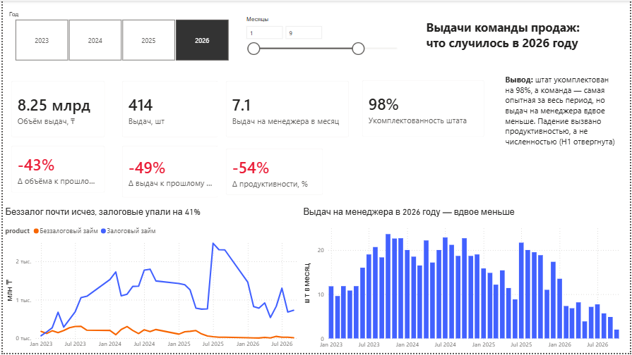
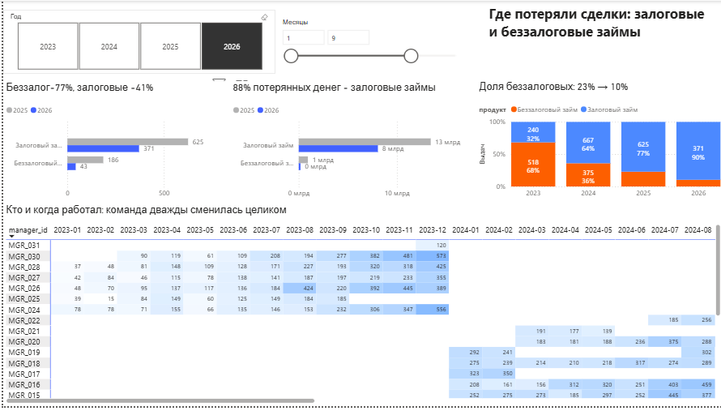
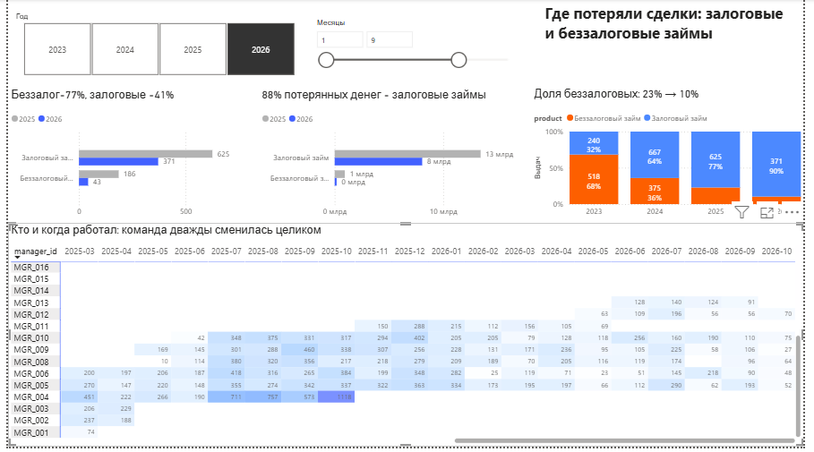
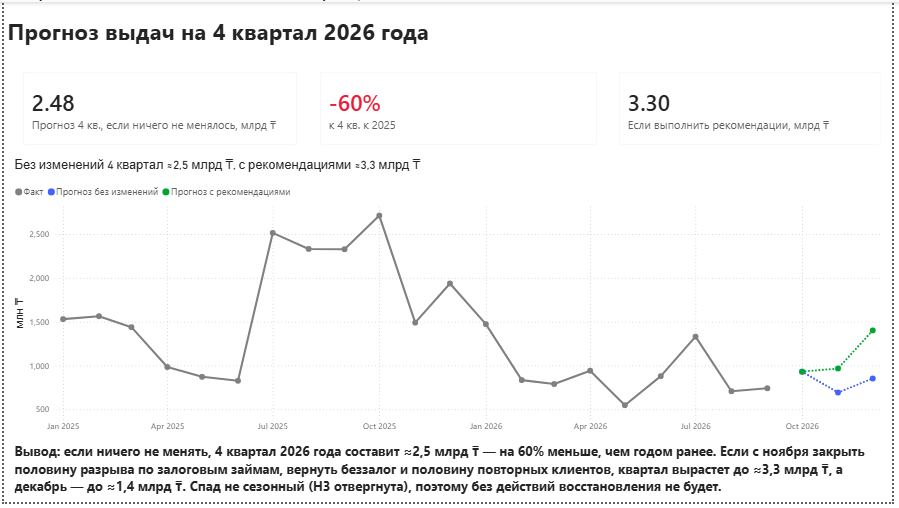

# Дашборд в Power BI: инструкция по сборке

Готовый отчёт: [`fintech_loans_dashboard.pbix`](fintech_loans_dashboard.pbix), PDF-версия: [`fintech_loans_dashboard.pdf`](fintech_loans_dashboard.pdf).

**Страница 1. Что случилось** — штат укомплектован на 98%, но выдач на менеджера вдвое меньше


**Страница 2. Где потеряли сделки** — залоговые и беззалоговые займы, смена команды (матрица прокручивается, поэтому 2 скриншота)



**Страница 3. Что будет в 4 квартале** — прогноз без изменений и с рекомендациями


---

Отчёт для руководителя продаж: 3 страницы, каждая отвечает на один вопрос.
1. Что случилось?
2. Где потеряли сделки?
3. Что будет в 4 квартале?

## 1. Данные

```bash
python src/build_db.py          # SQLite из исходного xlsx
# выполнить ноутбук целиком (считает прогноз, §6.3–6.4)
python src/export_powerbi.py    # → data/powerbi/*.csv
```

| Таблица | Что внутри | Ключ |
|---|---|---|
| `fact_loans` | 1 строка = 1 выдача: дата, менеджер, клиент, продукт, канал, сегмент, сумма, повторная ли выдача | `loan_id` |
| `dim_date` | Календарь 2023–2026: год, квартал, месяц по-русски, день недели, «последние 5 дней месяца» | `date` |
| `dim_manager` | Период работы, месяцев в команде, тип найма, статус (работает / уволился) | `manager_id` |
| `dim_channel` | Канал (застройщик, стандарт, вторичка, ЦИ…) и застройщик | `channel_key` |
| `fact_forecast` | Прогноз на октябрь–декабрь 2026: база, диапазон, 3 сценария, млн ₸ | `month_start` |

## 2. Модель (вкладка «Модель»)

```
dim_date[date]           1 ──< *  fact_loans[date]
dim_manager[manager_id]  1 ──< *  fact_loans[manager_id]
dim_channel[channel_key] 1 ──< *  fact_loans[channel_key]
dim_date[date]           1 ──< *  fact_forecast[month_start]
```

- **Получить данные → Текст/CSV**, кодировка 65001 (UTF-8). Проверьте, что `date` и `month_start` распознаны как «Дата».
- `dim_date` → **Пометить как таблицу дат** по полю `date`.
- `dim_date[month_name]` → **Сортировать по столбцу** `month_num`; `weekday` → по `weekday_num`.
- Меры скопируйте из [`measures.dax`](measures.dax) в отдельную таблицу `_Меры`.
- Формат: `Δ … %` и `Доля …` — проценты без десятичных; суммы в млн ₸ — без десятичных, с разделителем тысяч.

## 3. Страницы и визуалы

### Страница 1. Обзор: «Что случилось»
Срез сверху: `dim_date[year]` (кнопки) и `dim_date[month_num]` (диапазон 1–9 по умолчанию, чтобы сравнение было честным — октябрь 2026 неполный).

| Визуал | Поля | Что показывает |
|---|---|---|
| 4 карточки (Card new) | `Объём, млрд ₸` + `Δ объёма к прошлому году, %`; `Выдач` + `Δ выдач…, %`; `Выдач на менеджера в месяц` + `Δ продуктивности, %`; `Медианный залоговый чек, млн ₸` | 2026: −43% объёма, −54% продуктивности, чек не изменился |
| Линейчатая (линии) | Ось: `dim_date[month_start]`; значения: `Объём, млн ₸`; легенда: `fact_loans[product]` | Беззалог сходит на нет с 2024 года |
| Гистограмма | Ось: `month_start`; значение: `Выдач на менеджера в месяц` | Провал продуктивности в 2026 году |
| Карточка | `Укомплектованность штата` | Штат (6, с мая 2026 — 7) заполнен на 98%: дело не в людях |
| Текстовое поле | 1 предложение-вывод | «Команда не уменьшилась — упала продуктивность» |

### Страница 2. Продукты и команда: «Где потеряли сделки»
Канал/партнёр указан не во всех заявках, поэтому сравнение строим только по продукту: залоговые и беззалоговые.
Срез: `dim_date[month_num]` 1–9, `dim_date[year]` = 2026.

| Визуал | Поля | Что показывает |
|---|---|---|
| Линейчатая горизонтальная ×2 | Ось: `fact_loans[product]`; значения: `Δ выдач к прошлому году, шт` и `Δ объёма к прошлому году, %` | Беззалог −77% по штукам, но 88% потерянных денег — залоговые |
| 100% линейчатая с накоплением | Ось: `dim_date[year]`; значение: `Выдач`; легенда: `fact_loans[product]` | Доля беззалоговых 23% → 10% |
| Матрица «тепловая карта» | Строки: `dim_manager[manager_id]`; столбцы: `dim_date[year_month]`; значения: `Объём, млн ₸`; фон — цветовая шкала | Кто и когда работал: команда сменилась целиком дважды |
| Таблица | `manager_id`, `hire_type`, `status`, `months_active`, `Объём, млн ₸`, `Доля в объёме команды` (гистограмма данных) | Зависимость от топ-2 менеджеров |

### Страница 3. Клиенты и прогноз: «Что будет в 4 квартале»

| Визуал | Поля | Что показывает |
|---|---|---|
| Гистограмма | Ось: `month_start` (фильтр 01–09.2025); значение: `Доля повторных выдач` | Повторные клиенты давали ≈22% выдач |
| Карточки | `Прогноз 4 кв.: база, млрд ₸`; `Прогноз 4 кв. к 2025, %`; `Прогноз 4 кв.: все шаги, млрд ₸` | 2,5 млрд ₸ (−60%) → 3,3 млрд ₸ при выполнении плана |
| Линейчатая (линии) | Ось: `month_start` (фильтр с 01.2025); значения: `Факт для прогноза`, `Прогноз: база`, `Прогноз: все шаги`. Для базы включите **Полосы ошибок** (Аналитика → Error bars): верхняя = `Прогноз: верхняя граница`, нижняя = `Прогноз: нижняя граница` | Факт + прогноз с диапазоном и сценарием |
| Кластеризованная гистограмма | Ось: `month_start` (10–12.2026); значения: 4 меры прогноза | Вклад каждого шага в сценарий |

## 4. Оформление
- Тема: светлая, 2 акцентных цвета — синий `#2A78D6` для залоговых/факта и оранжевый `#EB6834` для беззалоговых/сценария; красный только для потерь.
- Заголовок каждого визуала — вывод, а не название метрики: «88% потерянных денег — залоговые займы», а не «Выдачи по продуктам».
- Подпишите источник внизу страницы: «Данные обезличены; октябрь 2026 — по 12.10».

## 5. Публикация для портфолио
- **Publish to web** (Power BI Service → Файл → Внедрить отчёт → Опубликовать в Интернете) даёт публичную ссылку. Нужна рабочая учётная запись и разрешение администратора; данные станут публичными.
- Если публиковать нельзя: `.pbix`, PDF и скриншоты страниц (`images/powerbi_*.png`) лежат в репозитории — см. начало этого файла.
