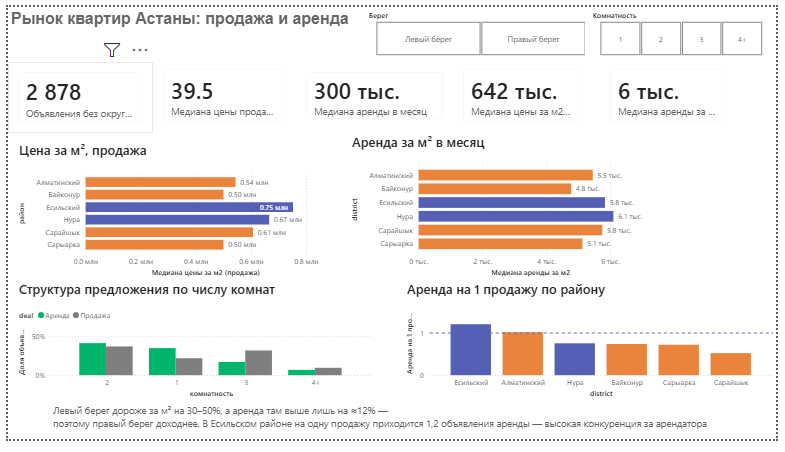
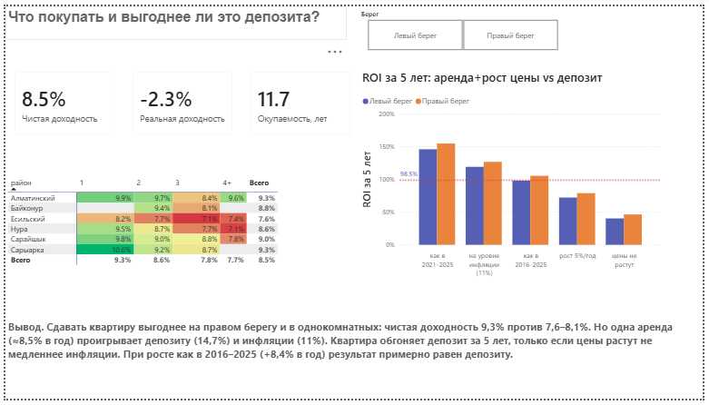
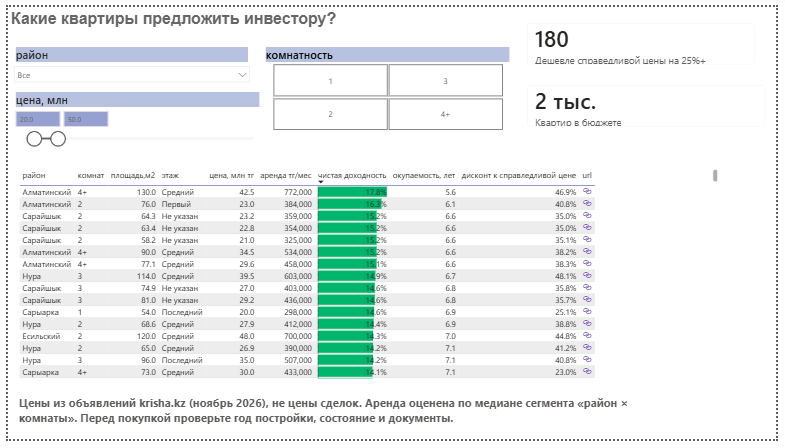

# Квартира под сдачу в Астане: где инвестиция окупается быстрее

**Сквозной аналитический проект на данных krisha.kz: объявления о продаже и аренде квартир в Астане**

> 📌 **Summary**
> 1. **Выгоднее всего сдавать однушки на правом берегу.** Чистая доходность однокомнатных квартир 9,3% против 7,8% у трёхкомнатных,
>    правого берега 9,3% против 8,1% у левого. Обе гипотезы подтверждены (U-тест, p < 0,001), эффект виден в каждом районе.
> 2. **Одна аренда не обгоняет ни депозит, ни инфляцию.** Медианная чистая доходность 8,5% при депозите 14,7% и инфляции 11%,
>    реальная доходность −2,3%, окупаемость ≈12 лет. Квартира выигрывает у депозита за 5 лет, только если цены растут
>    не медленнее инфляции; при росте как в 2016–2025 (+8,4% в год) результат примерно равен депозиту.
> 3. **Модель справедливой цены находит недооценённые квартиры.** Регрессия объясняет 81% разброса цен (R² = 0,81, MAPE 19%);
>    в бюджете 20–50 млн ₸ найдено 180 объявлений, которые на 25% и больше дешевле прогноза. Это готовый список для брокеров.

---

## 1. Бизнес-проблема

**Заказчик:** агентство недвижимости в Астане с услугой **инвест-подбора**. Агентство подбирает
клиентам квартиры для покупки под сдачу в аренду и получает комиссию с каждой сделки.

**Ситуация.** Клиенты агентства — частные инвесторы с бюджетом 20–50 млн ₸: жители Астаны, а также
инвесторы из Алматы и регионов, которые покупают квартиры в столице удалённо. Каждый задаёт
один и тот же вопрос: *«Что купить, чтобы деньги вернулись быстрее?»* Сейчас брокеры отвечают
по опыту и ощущениям. Из-за этого:

- рекомендации разных брокеров противоречат друг другу, и клиенты перестают доверять агентству;
- клиенты сравнивают доходность квартиры с депозитом и не видят цифр, которые оправдывают покупку;
- брокеры тратят часы на ручной поиск «выгодных» объявлений и пропускают квартиры, выставленные
  ниже рынка, — их быстрее забирают конкуренты.

**Ключевой вопрос:**
*Какие квартиры в Астане (район, берег, число комнат, этаж, высотность дома) дают самую высокую арендную доходность
и самый короткий срок окупаемости — и как быстро находить объявления, выставленные ниже рынка?*

**Что нужно бизнесу на выходе:**
1. Рейтинг районов Астаны по арендной доходности и сроку окупаемости.
2. Сравнение сегментов: 1-, 2-, 3-комнатные; высотность дома; этажи.
3. Модель «справедливой цены» квартиры — чтобы находить объявления, выставленные дешевле рынка.
4. Готовые аргументы для клиента: «эта квартира окупится за N лет против M лет в среднем по городу».

## 2. Стейкхолдеры

| Роль | Что важно | Как использует результат |
|---|---|---|
| **Директор агентства** — основной заказчик | Рост числа сделок и доверия клиентов | Утверждает стандарт инвест-рекомендаций |
| Брокеры | Быстро найти выгодные объекты | Используют рейтинг районов и список недооценённых квартир |
| Клиенты-инвесторы | Окупаемость и риск | Получают сравнение вариантов в цифрах |
| Маркетинг агентства | Сильный оффер | Публикует аналитику рынка как лид-магнит |

## 3. Метрики (KPI)

| Метрика | Формула / смысл |
|---|---|
| Цена за м² | Цена продажи / площадь |
| Аренда за м² | Месячная аренда / площадь |
| **Валовая доходность (gross yield)** | `аренда × 12 / цена покупки` |
| **Чистая доходность (net yield)** | `(аренда × 12 × 11/12 × 0.9 − площадь × 60 ₸ × 12) / цена` — 1 месяц простоя, налог 10%, содержание 60 ₸/м² в месяц |
| **Срок окупаемости** | `цена / (годовая аренда за вычетом расходов)`, лет |
| **Реальная доходность** | `(1 + чистая доходность) / (1 + инфляция) − 1` — средняя инфляция в РК за янв 2025 – сен 2026: 11,0% |
| **ROI за 5 лет** | `(чистый арендный доход за 5 лет + рост цены) / цена` — сценарии роста цен и аренды: 0%, 5%, на уровне инфляции, как в 2016–2025 и как в 2021–2025 (индексы цен БНС) |
| **Реальный ROI за 5 лет** | `(1 + ROI) / (1 + инфляция)^5 − 1` |
| Сравнение с депозитом | ставка по срочным депозитам физлиц в тенге (≈14,7% годовых, Нацбанк РК, июнь 2026) — номинально и реально |
| Дисконт к рынку | `(справедливая цена по модели − цена объявления) / справедливая цена` |

Доходность считается по сегментам «район × число комнат». Каждому объявлению о продаже
сопоставляется медианная аренда за м² в его сегменте.

## 4. Гипотезы

**H1. Однокомнатные квартиры доходнее больших.**
Медианная валовая доходность однокомнатных квартир выше, чем трёхкомнатных: аренда за м²
у маленьких квартир растёт быстрее, чем цена за м².
- *H₀:* распределения доходности 1- и 3-комнатных квартир не различаются.
- *Тест:* U-критерий Манна–Уитни, α = 0.05; бутстрэп-интервал для разницы медиан.
- *Если подтвердится:* агентство по умолчанию предлагает клиентам с небольшим бюджетом
  1-комнатные квартиры, а клиентам с большим бюджетом — две «однушки» вместо одной «трёшки».

**H2. Правый берег доходнее левого.**
На левом берегу (Есильский район и район Нура) квартиры заметно дороже, а арендные ставки
отличаются от правого берега (Алматинский, Сарайшык, Сарыаркинский, Байконур) меньше, чем цены.
Поэтому валовая доходность на правом берегу выше.
- *H₀:* доходность квартир на левом и правом берегу не различается.
- *Тест:* U-критерий Манна–Уитни по сопоставимым сегментам (то же число комнат).
- *Если подтвердится:* инвесторам, которым важна окупаемость, агентство предлагает правый берег,
  а левый — тем, кому важнее престиж и рост стоимости.

**H3. Первый и последний этажи продаются с дисконтом.**
При прочих равных квартиры на первом и последнем этаже стоят за м² **минимум на 5% дешевле**,
чем на средних этажах.
- *H₀:* цена за м² не зависит от того, крайний этаж или нет.
- *Тест:* U-критерий Манна–Уитни; в регрессии — значимость коэффициента «крайний этаж».
- *Если подтвердится:* брокеры используют дисконт как аргумент в торге при покупке и учитывают его
  при оценке доходности.

**Регрессия (этап 6):** `log(цена) ~ площадь + комнаты + район + высотность дома + тип этажа`.
Коэффициенты показывают вклад каждого фактора в процентах, точность — R² и MAE.
Объявления, где цена заметно ниже прогноза модели, — кандидаты в «недооценённые».

## 5. Данные

- **Источник:** krisha.kz — объявления о продаже и аренде квартир в Астане.
  Сбор — собственный парсер с паузами между запросами; телефоны и имена продавцов не собираются.
- **Поля:** цена, число комнат, площадь, этаж и этажность, адрес и район (по району определяется берег), дата сбора.
- **Ограничения:**
  - это цены **предложения**, а не сделок: реальные цены обычно немного ниже;
  - выгрузка 3 ноября 2026: ≈3000 последних объявлений продажи и ≈3000 аренды (лимит 150 страниц) —
    это свежий срез рынка, а не все объявления Астаны; дат публикации нет, поэтому сезонность не анализируется;
  - год постройки и тип дома недоступны (страницы объявлений закрыты защитой от ботов) —
    вместо них используется высотность дома;
  - аренда и продажа — разные квартиры, поэтому доходность считается по сегментам, а не по конкретной квартире;
  - объявления бывают дублями и с ошибками ввода (площадь 5 м², цена 1 ₸) — чистятся на этапе предобработки.
  - район Сарайшык выделен из южной части Алматинского района; в части объявлений может стоять
    старое название района — на берег это не влияет, оба района на правом берегу;
  - **улица** Сарайшык находится на левом берегу (Есильский район) — берег определяем по полю «район»,
    а не по тексту адреса.

## 6. Результаты

### Гипотезы (этап 7)

| Гипотеза | Результат | Вердикт |
|---|---|---|
| **H1.** Однушки доходнее трёшек | Медиана чистой доходности 9,34% против 7,82%: **+1,5 п.п.** (95% ДИ +1,3…+1,9), p ≈ 10⁻⁴²; аренда за м² у однушек выше на 19%, а цена за м² ниже на 3%. Эффект есть во всех 6 районах | ✅ Подтверждена |
| **H2.** Правый берег доходнее левого | 9,26% против 8,05%: **+1,2 п.п.** (95% ДИ +1,0…+1,4), p < 0,001; эффект сохраняется в каждой группе по числу комнат | ✅ Подтверждена |
| **H3.** Крайние этажи дешевле на 5%+ | Цена за м² ниже на **7,1%** (95% ДИ −10,4…−4,1%): первый этаж −6,5%, последний −7,5%. Тест на порог 5%: p = 0,013 при α = 0,017 (поправка Бонферрони) | ✅ Подтверждена (на границе) |

### Модель справедливой цены (этап 6)

`LinearRegression` на `log(цена)`: **R² = 0,81** (кросс-валидация 0,81 ± 0,01), **MAE = 10,8 млн ₸, MAPE = 19%**.
При прочих равных квартиры на правом берегу дешевле, чем в Есильском районе: Байконур −33%, Сарыарка −31%, Алматинский −25%,
Сарайшык −16%, Нура −10%. Последний этаж даёт −8%, первый −6%, малоэтажный дом −6%, высотка +6%.
Объявлений дешевле прогноза на 25% и больше в бюджете 20–50 млн ₸: **180**.

### Доходность против депозита (этап 5)

| Показатель | Значение |
|---|---|
| Медианная чистая доходность | 8,5% в год |
| Реальная доходность (за вычетом инфляции 11%) | −2,3% |
| Окупаемость | ≈12 лет |
| Депозит 14,7% за 5 лет | +98,5% |
| ROI за 5 лет, если цены не растут | +40% (левый берег) / +46% (правый) |
| ROI за 5 лет при росте цен 5% в год | +72% / +79% |
| ROI за 5 лет при росте как в 2016–2025 (+8,4% в год) | +98% / +105%, на уровне депозита |
| ROI за 5 лет при росте на уровне инфляции (11%) | +119% / +127%, выше депозита |
| ROI за 5 лет при росте как в 2021–2025 | +146% / +154% |

За 10 лет (2016–2025, индексы БНС) вторичное жильё Астаны дорожало на 8,4% в год при инфляции 9,2%:
в реальном выражении квартиры подешевели примерно на 0,8% в год.

## 7. Дашборд (Power BI)

Файл `dashboard/krisha_astana.pbix`, PDF-версия: `dashboard/krisha_astana.pdf`. Инструкция по сборке: `dashboard/POWERBI_GUIDE.md`.

| Страница | Для кого и зачем |
|---|---|
| **Обзор рынка** | Директору: цены и аренда по районам, структура предложения |
| **Доходность** | Брокеру и клиенту: тепловая карта «район × комнаты», ROI за 5 лет против депозита |
| **Шорт-лист** | Брокеру: конкретные квартиры в бюджете клиента со ссылками на krisha.kz, отсортированные по доходности |





## 8. Рекомендации бизнесу

1. **Сделать однушки на правом берегу продуктом по умолчанию.** Клиентам, которым важна доходность, предлагать
   1-комнатные квартиры в Сарыарке, Алматинском и Сарайшыке (9,8–10,0% чистыми). Клиентам с бюджетом 40–50 млн ₸
   показывать вариант «две однушки вместо одной трёшки»: +1,5 п.п. доходности при той же сумме.
2. **Продавать «аренду + рост цены», а не одну аренду.** Аренда сама по себе даёт меньше депозита, и клиент это быстро посчитает.
   Брокер показывает клиенту график ROI за 5 лет против депозита и честно объясняет: покупка выгодна, если клиент ждёт роста цен
   хотя бы на уровне инфляции или хочет защитить сбережения реальным активом. Это сохраняет доверие и снижает отказы после сделки.
3. **Раз в неделю обновлять шорт-лист недооценённых квартир.** Запускать парсер и модель справедливой цены, отдавать брокерам
   объявления на 25%+ дешевле прогноза. Сейчас их 180 в бюджете клиентов. Каждое проверять вручную: ошибка модели ≈19%,
   и часть «дешёвых» квартир дешёвая из-за состояния или документов.
4. **Использовать крайний этаж как аргумент в торге.** Первый и последний этажи в среднем дешевле на 6–8%. Если клиент готов
   на такой этаж, брокер просит скидку не меньше этой величины.
5. **Левый берег предлагать под другую цель.** Есильский район даёт самую низкую доходность (7,6%, у трёшек 7,1%).
   Его стоит предлагать клиентам, которым важны престиж и ликвидность, а не окупаемость.

**Следующие шаги:** собирать данные ежемесячно, чтобы видеть динамику и сезонность; добавить цены сделок (статистика сделок БНС, данные нотариата)
вместо цен предложения; вернуть в модель год постройки и тип дома, когда появится доступ к страницам объявлений.

## 9. Структура проекта

```
├── README.md
├── LICENSE                     # MIT
├── requirements.txt
├── krisha_parser.py            # парсер
├── build_db.py                 # загрузка CSV в SQLite
├── 01_data_collection.ipynb    # этап 2: сбор
├── 02_sql.ipynb                # этап 2: SQL-срезы
├── 03_preprocessing.ipynb      # этап 3
├── 04_eda_metrics.ipynb        # этапы 4–5: EDA и метрики доходности
├── 05_regression.ipynb         # этап 6: модель справедливой цены
├── 06_hypotheses.ipynb         # этап 7
├── 07_powerbi_export.ipynb     # этап 8: выгрузка таблиц для Power BI
├── sql/queries.sql
├── dashboard/                  # этап 8: .pbix, PDF, скриншоты, меры DAX, тема
└── data/
    ├── raw/listings_20261103.csv  # выгрузка krisha.kz, 3 ноября 2026
    └── stat/                      # индексы цен на жильё и цены БНС (xlsx)
```

## 10. Как запустить

```bash
pip install -r requirements.txt
jupyter lab
```

Выгрузка krisha.kz уже лежит в `data/raw/`, поэтому ноутбук `01_data_collection` (парсер, ≈150 страниц) запускать не обязательно.
Дальше по порядку: `02_sql` → `03_preprocessing` → `04_eda_metrics` → `05_regression` → `06_hypotheses` → `07_powerbi_export`.
Промежуточные таблицы (`data/*.pkl`, `data/krisha.db`, `dashboard/data/`) создаются автоматически.
