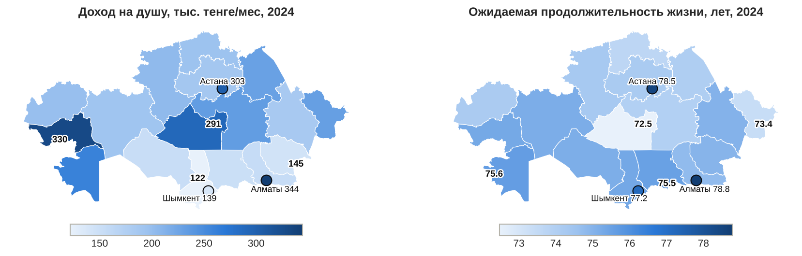
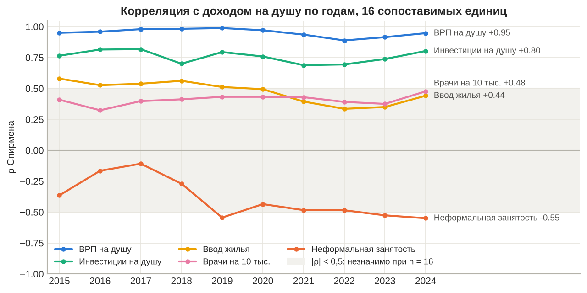
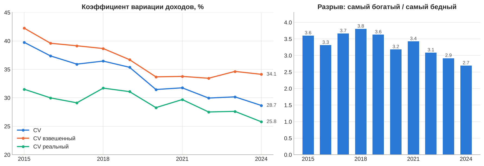
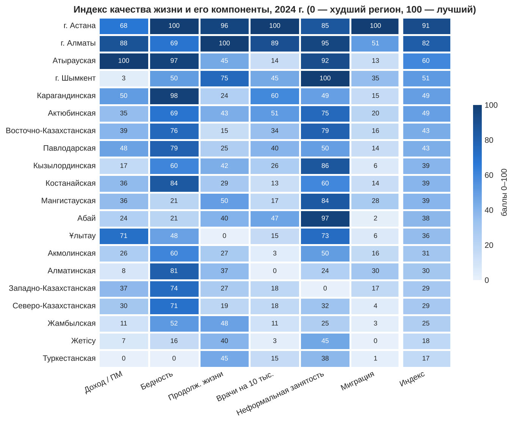
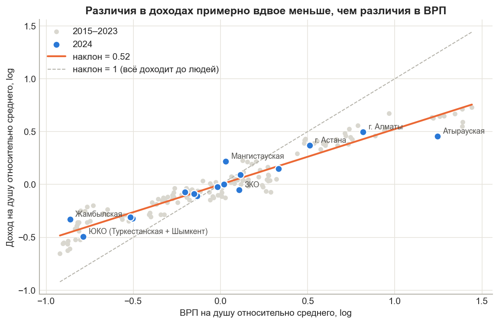
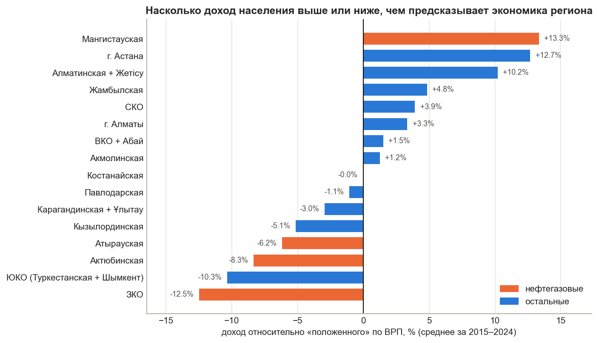
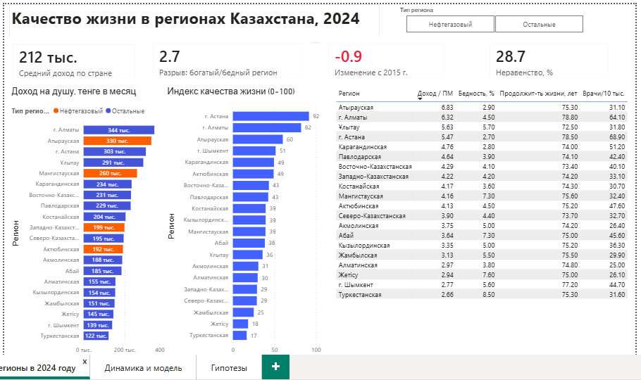
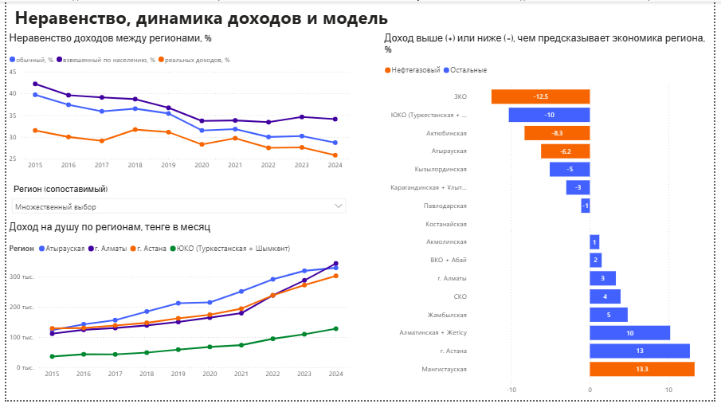
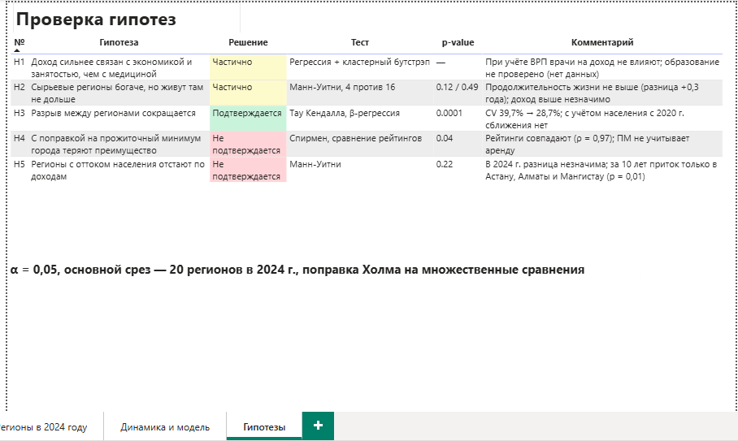

# Качество жизни в регионах Казахстана: от чего зависят доходы населения

> **Проект 3 · Социальная аналитика · Республика Казахстан, 2015–2024**
> Python (Pandas, Seaborn, scikit-learn, SciPy) · SQL (SQLite) · Power BI

## 📌 Summary — 3 главных вывода
1. **Разрыв между регионами сокращается, но мегаполисы держат отрыв.** В 2015 г. самый богатый регион опережал самый бедный в 3,6 раза, в 2024 г. — в 2,7; коэффициент вариации доходов снизился с 39,7% до 28,7% (p = 0,0001). Но с учётом численности населения сближение с 2020 г. остановилось: Алматы и Астана растут наравне с остальными.
2. **Доход региона определяется его экономикой, но доходит до людей наполовину.** Один ВРП на душу объясняет 89% различий в доходах и предсказывает доход 2022–2024 гг. с ошибкой 7,6%. Эластичность ≈ 0,5: вдвое большая экономика даёт доход выше лишь на ≈44%. Нефтегазовые ЗКО, Актюбинская и Атырауская устойчиво получают на 6–12% меньше, чем предсказывает их ВРП.
3. **Деньги не равны здоровью.** Доход и продолжительность жизни по регионам не связаны (ρ = −0,08): Ұлытау — 4-я по доходу и последняя по продолжительности жизни. По сводному индексу качества жизни устойчиво отстают Туркестанская, Жетісу и Жамбылская.

---

## Оглавление
1. [Бизнес-задача](#1-бизнес-задача)
2. [Стейкхолдеры](#2-стейкхолдеры)
3. [Гипотезы](#3-гипотезы)
4. [Данные](#4-данные)
5. [Метрики](#5-метрики)
6. [План работ](#6-план-работ)
7. [Выводы и рекомендации](#7-выводы-и-рекомендации)
8. [Структура репозитория](#8-структура-репозитория)
9. [Как запустить](#9-как-запустить)

---

## 1. Бизнес-задача

В Казахстане 20 регионов (17 областей и 3 города республиканского значения), и уровень жизни в них сильно различается: сырьевые области запада и крупные города выделяются по доходам, а ряд северных и южных регионов отстаёт и теряет население из-за миграции.

Государство ежегодно распределяет бюджет на развитие регионов: строительство больниц и школ, программы занятости, субсидии на жильё. **Вопрос: какие из этих направлений сильнее всего связаны с ростом доходов населения и в какие регионы вкладываться в первую очередь?**

**Цель проекта:** на панельных данных Бюро национальной статистики за 2015–2024 гг.
- определить, какие факторы (образование, здравоохранение, занятость, инвестиции, жильё) сильнее всего связаны со среднедушевыми доходами населения;
- выяснить, сокращается ли разрыв между регионами;
- выделить регионы-приоритеты и дать 3–5 рекомендаций по распределению бюджета развития.

**Целевая переменная:** среднедушевые номинальные денежные доходы населения (тенге в месяц), дополнительно — в реальном выражении (с поправкой на прожиточный минимум региона).

## 2. Стейкхолдеры

| Роль | Что им нужно от анализа |
|---|---|
| **Основной заказчик:** департамент регионального развития Министерства национальной экономики РК | Приоритеты бюджета: какие регионы и какие направления дают наибольший эффект |
| Акиматы областей | Позиция своего региона относительно других и по каким показателям он отстаёт |
| Аналитики и журналисты | Прозрачная и воспроизводимая картина неравенства между регионами |

Все выводы пишутся для **основного заказчика**: аудитория — не технические специалисты, ответ должен быть в формате «куда направить деньги».

## 3. Гипотезы

| № | Гипотеза | Как проверяли | Результат |
|---|---|---|---|
| H1 | Доходы сильнее связаны с образованием и занятостью, чем с обеспеченностью медициной | Регрессия + кластерный бутстрэп | ⚠️ **Частично.** При учёте ВРП врачи на доход не влияют (β = 0,02, ДИ включает 0). Образование не проверено — нет данных по регионам |
| H2 | Сырьевые регионы имеют значимо более высокие доходы, но не более высокую продолжительность жизни | U-тест Манна-Уитни, 4 против 16 регионов | ⚠️ **Частично.** Продолжительность жизни не различается (разница +0,3 года, ДИ −0,7…+1,3). Доход выше незначимо (p = 0,12): ЗКО и Актюбинская ниже среднего |
| H3 | Разрыв в доходах между регионами за 2015–2024 гг. сокращается | Тау Кендалла для тренда CV, β-регрессия | ✅ **Подтверждается** (τ = −0,87, p = 0,0001; значима и после поправки Холма). С учётом населения с 2020 г. сближение остановилось |
| H4 | С поправкой на прожиточный минимум города теряют часть преимущества | Спирмен, сравнение рейтингов | ❌ **Не подтверждается.** Рейтинги совпадают (ρ = 0,97), города теряют максимум 1 место. ПМ не учитывает аренду — ограничение данных |
| H5 | Регионы с оттоком населения отстают по доходам | U-тест Манна-Уитни, t-тест Уэлча | ❌ **На основном срезе 2024 г. — нет** (p = 0,22). На горизонте 10 лет — да (p = 0,01): устойчивый приток только в Астану, Алматы и Мангистау |

Правила проверки зафиксированы заранее: α = 0,05, основной срез — 20 регионов в 2024 г., поправка Холма на множественные сравнения. Подробно — в [ноутбуке этапа 7](notebooks/05_hypotheses.ipynb).

> Если гипотеза не подтвердится, это тоже результат, и он будет описан в выводах.

## 4. Данные

**Источник:** Бюро национальной статистики АСПиР РК — [stat.gov.kz](https://stat.gov.kz) (ИАС «Талдау», динамические ряды по регионам).
**Период:** 2015–2024 (население — по 2025), годовые данные. **Гранулярность:** регион × год.
**Геоданные:** границы регионов (GeoJSON) для хороплет-карт.

⚠️ **Особенность данных: границы регионов менялись дважды.**
- В 2018 г. Южно-Казахстанская область разделена на Туркестанскую область и г. Шымкент.
- В 2022 г. созданы области Абай, Жетісу и Ұлытау (выделены из Восточно-Казахстанской, Алматинской и Карагандинской).

Поэтому в базе два среза:
- **`v_panel_regions`** — регионы в границах своего года (16 → 17 → 20 единиц): для карт и сравнений 2022–2024;
- **`v_panel_units`** — **16 сопоставимых единиц** в границах до 2018 г.: для динамики 2015–2024 и регрессии. Абсолютные показатели складываются, относительные усредняются с весами по населению. Проверка: сумма 16 единиц совпадает с итогом по стране на 100,00% по населению, инвестициям и ВРП (запрос `q10`).

**Ограничения данных**
- Зарплата — без учёта малых предприятий, занимающихся предпринимательской деятельностью: уровень завышен относительно реального.
- Образование: доля рабочей силы по уровню образования в Талдау есть только в целом по РК (2019–2025), по регионам ряд не публикуется. Поэтому в H1 образование не участвует, проверяется связь доходов с медициной, занятостью и инвестициями.
- Продолжительность жизни для объединённых единиц (например, ВКО + Абай) — среднее, взвешенное по населению. Это приближение: точный расчёт требует таблиц смертности, которых в открытом доступе нет.
- Безработица по регионам почти не различается (4,0–5,3%): как фактор регрессии слабый.
- Прожиточный минимум публикуется поквартально, годовое значение — среднее за кварталы; в год реформы у новых регионов 3 квартала.
- ВРП: БНС пересчитал Туркестанскую обл. и Шымкент назад до 2011 г., но оставил и ЮКО за 2015–2017 гг. Для единообразия с другими файлами за эти годы используется ЮКО (иначе двойной счёт).
- Показатели «на душу» на этапе 3 пересчитаны: потоки (инвестиции, ВРП, ввод жилья) — на среднегодовое население, врачи — на население на конец года. С этой базой расчёт совпадает с официальным числом врачей на 10 тыс. в 90% случаев (против 57% при населении на начало года).

**Методологические разрывы в рядах** (найдены на этапе 3, в данных отмечены флагами)
- **2018 г.** — пересмотренная методика прожиточного минимума: доля бедных выросла в 15 из 16 регионов, медиана 2,6% → 3,9%. Динамику бедности сравниваем только с 2018 г. (`poverty_break`).
- **2020–2021 гг.** — пандемия: медиана продолжительности жизни упала с 72,8 до 69,8 года (`covid`).
- **2022 г.** — население пересчитано по итогам переписи 2021 г.: +3,3% за год при обычных 1,3% (`census_base`).
- **Астана и Акмолинская обл., 2016 г.** — сальдо миграции +82,7 и −20,6 на 1000 при росте населения Астаны на 11,5%: похоже на изменение границ, а не на обычную миграцию (`migration_anomaly`).

Список показателей и инструкция по выгрузке — в [`data/README_data.md`](data/README_data.md).

## 5. Метрики

В социальном проекте нет LTV и CAC, поэтому этап 5 адаптирован под региональную аналитику:

| Метрика | Формула | Что показывает |
|---|---|---|
| CAGR доходов | (Доход₂₀₂₄ / Доход₂₀₁₅)^(1/9) − 1 | Среднегодовой темп роста |
| Индекс разрыва | max(доход) / min(доход) | Во сколько раз самый богатый регион опережает самый бедный |
| Коэффициент вариации (σ-конвергенция) | σ / μ × 100%, обычный и взвешенный по населению | Неравенство между регионами (проверка H3) |
| β-конвергенция | наклон регрессии CAGR на log(доход₂₀₁₅) | Догоняют ли бедные регионы богатых (H3) |
| Покупательная способность | Доход / прожиточный минимум | Реальный уровень жизни (проверка H4) |
| Индекс качества жизни | Среднее min-max (0–100) шести показателей: доход/ПМ, бедность, продолжительность жизни, врачи, неформальная занятость, миграция | Сводный рейтинг регионов; устойчивость проверена 2000 наборами случайных весов |

## 6. План работ

| Этап | Результат | Статус |
|---|---|---|
| 1. Постановка задачи | README: цель, гипотезы, стейкхолдеры | ✅ |
| 2. Сбор и выгрузка | База SQLite + `sql/queries.sql` (JOIN, CTE, оконные функции) | ✅ |
| 3. Предобработка | Чистый датафрейм, отчёт «до и после» очистки ([ноутбук](notebooks/01_preprocessing.ipynb)) | ✅ |
| 4. EDA | Распределения, корреляционная матрица, хороплет-карты ([ноутбук](notebooks/02_eda.ipynb)) | ✅ |
| 5. Расчёт метрик | Динамика CAGR, CV, покупательной способности, индекс качества жизни ([ноутбук](notebooks/03_metrics.ipynb)) | ✅ |
| 6. Прогноз | Линейная регрессия и Random Forest: факторы дохода, R², MAE ([ноутбук](notebooks/04_model.ipynb)) | ✅ |
| 7. Проверка гипотез | Манн-Уитни / T-тест, p-value, вывод ([ноутбук](notebooks/05_hypotheses.ipynb)) | ✅ |
| 8. Визуализация | Дашборд в Power BI ([инструкция](powerbi/README_powerbi.md)) | ✅ |
| 9. Выводы | Summary, рекомендации для Минэкономики, ограничения | ✅ |

### Ключевые графики


Карты почти не совпадают: доход сосредоточен на западе, в центре и в мегаполисах, а дольше живут на юге. Корреляция дохода и продолжительности жизни по 20 регионам — ρ = −0,08.


Доход стабильно связан с ВРП и инвестициями (ρ 0,7–0,99 все 10 лет), с медициной — слабо (≈ 0,4). Связь с неформальной занятостью за 10 лет усилилась с −0,1…−0,4 до −0,55.


Разрыв доходов между регионами сокращается: коэффициент вариации 39,7% → 28,7%, отношение самого богатого к самому бедному 3,6 → 2,7. С учётом численности населения сближение с 2020 г. остановилось — мегаполисы держат отрыв.


Индекс качества жизни совпадает с доходом лишь умеренно (ρ = 0,61). Устойчиво лучшие — Астана и Алматы, устойчиво худшие — Жетісу и Туркестанская.


Линейная регрессия на одном ВРП на душу объясняет 89–90% различий в доходах и предсказывает доход 2022–2024 гг. со средней ошибкой 7,6%. Эластичность ≈ 0,5: регион с вдвое большей экономикой на жителя имеет доход выше лишь на ≈44%. Врачи, ввод жилья и неформальная занятость при учёте ВРП значимо не влияют (кластерный бутстрэп).


Нефтегазовые ЗКО, Актюбинская и Атырауская устойчиво получают на 6–12% меньше, чем предсказывает их экономика; Мангистауская и Астана — на 13% больше.

## 7. Выводы и рекомендации

### Что узнали

| Вопрос заказчика | Ответ |
|---|---|
| С чем связаны доходы населения? | С экономикой региона (ВРП на душу, R² = 0,89). Врачи, ввод жилья и неформальная занятость при учёте ВРП значимо не влияют. Образование проверить нельзя — нет данных по регионам |
| Сокращается ли разрыв? | Да: 3,6× → 2,7×, бедные регионы растут быстрее (β-конвергенция, r = −0,73). Но с учётом населения с 2020 г. — нет |
| Меняет ли картину стоимость жизни? | По официальному прожиточному минимуму — почти нет (рейтинги совпадают на 97%). Исключение — Мангистауская обл., теряет 5 мест |
| Куда уезжают люди? | За 10 лет устойчивый приток только в Астану, Алматы и Мангистаускую обл. — три самых богатых единицы |
| Где жить лучше всего? | Устойчиво — Астана и Алматы; хуже всего — Туркестанская и Жетісу (в 90% вариантов весов индекса) |

### Рекомендации для Министерства национальной экономики

1. **Нацелить программы развития на устойчиво отстающий юг — Туркестанскую, Жетісу и Жамбылскую области.** Они внизу рейтинга качества жизни почти при любых весах индекса (в 90% из 2000 вариантов): самые низкие доходы, высокая бедность (5,5–8,5% при медиане по регионам 4,5%) и неформальная занятость, отток населения. Регионы из середины рейтинга менее приоритетны: их место зависит от выбора весов.
2. **Не рассчитывать, что рост ВРП сам поднимет доходы.** Эластичность ≈ 0,5: инвестиционные программы стоит сопровождать мерами, которые доводят рост до населения, — занятость, легализация неформальных рабочих мест, местные поставщики.
3. **Разобраться, куда уходит доход нефтегазовых регионов.** ЗКО, Актюбинская и Атырауская 9–10 лет из 10 получают на 6–12% меньше, чем предсказывает их экономика, а Мангистауская — на 13% больше. Следующий шаг — сравнить структуру занятости и зарплат по отраслям в этих регионах.
4. **Планировать здравоохранение отдельно от доходов.** В богатых центре и на востоке (Ұлытау, ВКО, Карагандинская, Павлодарская) продолжительность жизни одна из самых низких в стране — критерий «бедный регион» эти территории не выделит.
5. **Закрыть пробелы в данных.** Для решений нужны публикация доли рабочей силы с высшим образованием по регионам и региональный индекс стоимости жилья: без них нельзя проверить роль образования (H1) и реальную стоимость жизни в мегаполисах (H4).

### Ограничения

- Анализ показывает связи, а не причины: из корреляции и регрессии нельзя заключить, что рост ВРП *вызывает* рост доходов.
- 16–20 единиц — маленькая выборка: «значимой связи не найдено» не означает «связи нет».
- Зарплата не включает малые предприятия, прожиточный минимум не включает аренду, в рядах есть методологические разрывы 2018 и 2022 гг. (раздел 4).
- Объяснения причин (рента, бюджетные зарплаты, логистика) — гипотезы для дальнейшей проверки, в данных они не подтверждены.

### Что можно сделать дальше

- Добавить отраслевую структуру занятости и зарплат, чтобы объяснить остатки модели по нефтегазовым регионам.
- Повторить анализ на уровне районов, когда БНС опубликует сопоставимые ряды.
- Добавить карту (Shape map) в дашборд Power BI.

## 8. Структура репозитория

```
03_social_regions/
├── README.md
├── LICENSE                  # MIT
├── requirements.txt
├── .gitignore
├── data/
│   ├── README_data.md       # источники и инструкция по выгрузке
│   ├── raw/                 # исходные выгрузки БНС (Талдау, stat.gov.kz) + GeoJSON
│   ├── regions_kz.db        # база SQLite (создаётся скриптом, в .gitignore)
│   └── processed/           # результаты SQL-запросов, CSV (в .gitignore)
├── sql/
│   ├── schema.sql           # схема базы: regions, indicators, observations
│   └── queries.sql          # представления + 10 аналитических запросов
├── src/
│   ├── build_db.py          # raw → SQLite
│   └── run_queries.py       # queries.sql → data/processed/*.csv
├── notebooks/
│   ├── 01_preprocessing.ipynb   # этап 3: очистка → data/processed/panel_*_clean.csv
│   ├── 02_eda.ipynb             # этап 4: распределения, корреляции, карты
│   ├── 03_metrics.ipynb         # этап 5: CAGR, конвергенция, индекс качества жизни
│   ├── 04_model.ipynb           # этап 6: регрессия, прогноз, эластичность
│   └── 05_hypotheses.ipynb      # этап 7: проверка гипотез, итоговая таблица
├── powerbi/
│   ├── regions_kz_powerbi.xlsx   # данные для дашборда (5 листов)
│   ├── regions_kz_dashboard.pbix # дашборд Power BI
│   └── README_powerbi.md         # как собран дашборд
└── images/                  # графики для README (создаются ноутбуками)
```

## 9. Как запустить

```bash
git clone https://github.com/kalimuldinovaa-web/data-analytics-portfolio.git
cd data-analytics-portfolio/03_social_regions
pip install -r requirements.txt
python src/build_db.py        # собрать базу из data/raw
python src/run_queries.py     # выполнить SQL-запросы → data/processed
jupyter notebook notebooks/01_preprocessing.ipynb
```

### Дашборд

Откройте `powerbi/regions_kz_dashboard.pbix` в Power BI Desktop. Страницы: «Регионы в 2024 году» (доход, индекс качества жизни, фильтр по типу региона), «Динамика и модель» (неравенство по годам, доходы регионов, доход относительно ВРП) и «Гипотезы» (итоги проверки H1–H5). Как собран — в [`powerbi/README_powerbi.md`](powerbi/README_powerbi.md).





### Запросы этапа 2

| Запрос | Что делает | SQL-приёмы |
|---|---|---|
| `v_panel_regions` | Панель «регион × год», показатели на душу | CTE, условная агрегация (pivot), JOIN, LEFT JOIN |
| `v_panel_units` | 16 сопоставимых единиц: сумма / взвешенное среднее | 6 CTE, UNION ALL, CASE в агрегатах, проверка полноты |
| `q01_data_coverage` | Паспорт данных: годы, пропуски | агрегаты, LEFT JOIN со «скелетом» регион × год |
| `q04_income_dynamics` | Рейтинг, рост к прошлому году и к 2015 г. | RANK, LAG, FIRST_VALUE, именованное окно WINDOW |
| `q05_inequality_by_year` | Разрыв и коэффициент вариации (H3) | агрегаты, дисперсия через AVG(x²) − AVG(x)² |
| `q06_cagr_by_unit` | Среднегодовой рост, квартили 2015 г. | POWER, NTILE |
| `q07_resource_vs_other` | Сырьевые регионы против остальных (H2) | взвешенные средние, GROUP BY |
| `q08_latest_snapshot` | Срез последнего года для карты | CTE, RANK |
| `q09`, `q10` | Контроль качества: врачи на 10 тыс., сумма единиц = РК | JOIN, сверка с итогами |

---
*Лицензия: MIT*
