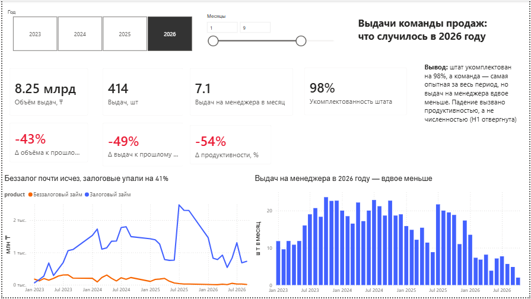
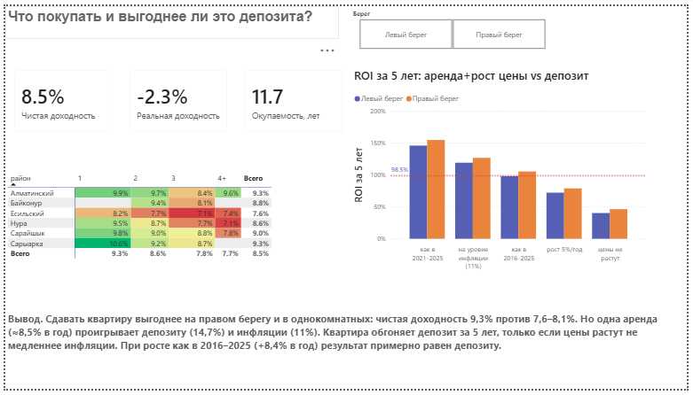
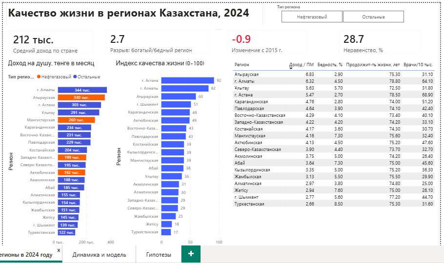

# 📊 Data Analytics Portfolio

**Arailym Kalimuldinova** · Junior Data Analyst · Астана

Ищу закономерности в данных Казахстана и перевожу их в решения для бизнеса и государства.

[](https://www.linkedin.com/in/arailym-kalimuldinova-99571444a)
[](https://github.com/kalimuldinovaa-web)


---

## Проекты за 30 секунд

| | Проект | Вопрос бизнеса | Главный результат |
|---|---|---|---|
| 🏦 | [**Кредитные выдачи банка**](./01_fintech_bank) | Почему команда продаж выдала на 43% меньше? | Дело не в людях, а в продуктивности: выдач на менеджера вдвое меньше. Прогноз 4 кв. — 2,5 млрд ₸, с рекомендациями — 3,3 млрд ₸ |
| 🏠 | [**Квартира под сдачу в Астане**](./02_real_estate_krisha) | Какую квартиру купить, чтобы инвестиция окупилась быстрее? | Однушки на правом берегу доходнее (9,3% против 7,8%), но одна аренда проигрывает депозиту. Модель нашла 180 квартир дешевле рынка |
| 🗺️ | [**Качество жизни в регионах РК**](./03_social_regions) | С чем связаны доходы населения и куда направлять бюджет? | Разрыв между регионами сократился с 3,6 до 2,7 раза. Доход определяется ВРП, но доходит до людей наполовину |

Каждый проект пройден целиком по 9 этапам: постановка задачи → SQL → предобработка → EDA → метрики → регрессия → проверка гипотез → дашборд → рекомендации.

---

## 🏦 1. Кредитные выдачи банка: куда пропали 6 млрд ₸

**Финтех и банкинг** · 4 049 выдач команды продаж, 2023–2026



- **Штат укомплектован на 98%**, но выдач на менеджера в месяц стало вдвое меньше: 15,6 → 7,1.
- **88% потерянных денег — залоговые займы**, хотя сильнее всего упали беззалоговые (−77%).
- **Спад не сезонный:** 2026 год ниже 2025-го в 8 из 9 месяцев (тест Уилкоксона, p = 0,006).
- **6 рекомендаций** с оценкой эффекта в тенге: от возврата залоговых сделок до удержания менеджеров.

`факторное разложение` `когорты` `retention` `прогноз` `Манн-Уитни` `χ²` `DAX`

📁 [Открыть проект](./01_fintech_bank)

---

## 🏠 2. Квартира под сдачу в Астане: где инвестиция окупается быстрее

**PropTech / недвижимость** · ≈5 600 объявлений krisha.kz, собранных собственным парсером



- **Однушки и правый берег доходнее:** 9,3% чистыми против 7,8% у трёшек и 8,1% на левом берегу.
- **Одна аренда (8,5%) проигрывает депозиту (14,7%) и инфляции (11%)**: квартира выигрывает за 5 лет, только если цены растут не медленнее инфляции.
- **Модель справедливой цены** (R² = 0,81) нашла 180 объявлений в бюджете 20–50 млн ₸, которые на 25%+ дешевле рынка. Это готовый шорт-лист для брокеров.

`веб-скрапинг` `оконные функции` `доходность и ROI` `регрессия` `бутстрэп` `Power BI`

📁 [Открыть проект](./02_real_estate_krisha)

---

## 🗺️ 3. Качество жизни в регионах Казахстана

**Социальная аналитика** · 20 регионов, данные БНС за 2015–2024



- **Разрыв сокращается:** коэффициент вариации доходов 39,7% → 28,7% (p = 0,0001), но мегаполисы с 2020 года держат отрыв.
- **ВРП на душу объясняет 89% различий в доходах**, эластичность ≈ 0,5: вдвое большая экономика даёт доход выше лишь на ≈44%.
- **Деньги не равны здоровью:** доход и продолжительность жизни не связаны (ρ = −0,08). Устойчиво отстают Туркестанская, Жетісу и Жамбылская области.

`панельные данные` `смена границ регионов` `конвергенция` `индекс качества жизни` `кластерный бутстрэп` `карты`

📁 [Открыть проект](./03_social_regions)

---

## Что я умею и где это посмотреть

| Навык | 🏦 Банк | 🏠 Недвижимость | 🗺️ Регионы |
|---|:---:|:---:|:---:|
| Сбор данных (выгрузки, API, парсинг) | ✅ | ✅ парсер | ✅ Талдау |
| SQL: CTE, JOIN, оконные функции | ✅ | ✅ | ✅ |
| Очистка данных, отчёт «до и после» | ✅ | ✅ | ✅ |
| Бизнес-метрики | retention, факторный анализ | доходность, окупаемость, ROI | CAGR, конвергенция, индекс |
| Регрессия и прогноз | ✅ | ✅ | ✅ |
| Статистические тесты | ✅ | ✅ | ✅ |
| Дашборд Power BI | ✅ | ✅ | ✅ |
| Рекомендации для бизнеса | 6 | 5 | 5 |

---

## Структура репозитория

```
data-analytics-portfolio/
├── 01_fintech_bank/          # Python, SQL, Power BI
├── 02_real_estate_krisha/    # парсер, Python, SQL, Power BI
└── 03_social_regions/        # Python, SQL, Power BI
```

В каждой папке свой README с постановкой задачи, гипотезами, результатами и инструкцией по запуску.

---

Проекты выполнены в рамках программы Data Analytics от TechOrda по ТЗ «Аналитика бизнес-показателей».

📬 Открыта к предложениям о работе: [LinkedIn](https://www.linkedin.com/in/arailym-kalimuldinova-99571444a)
